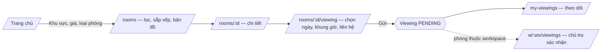
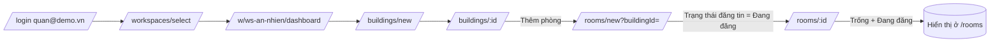
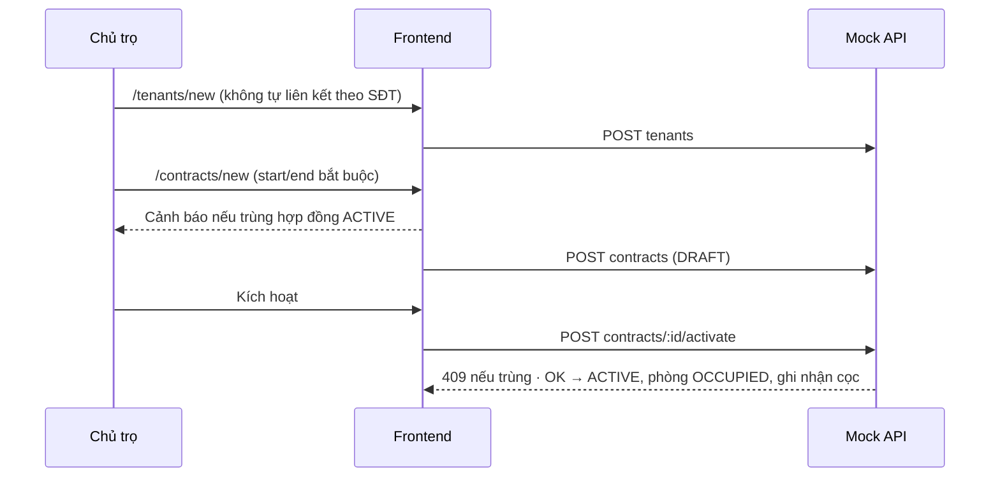
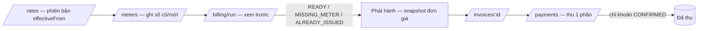
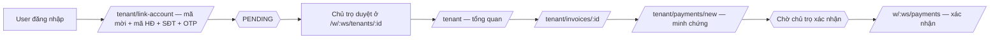
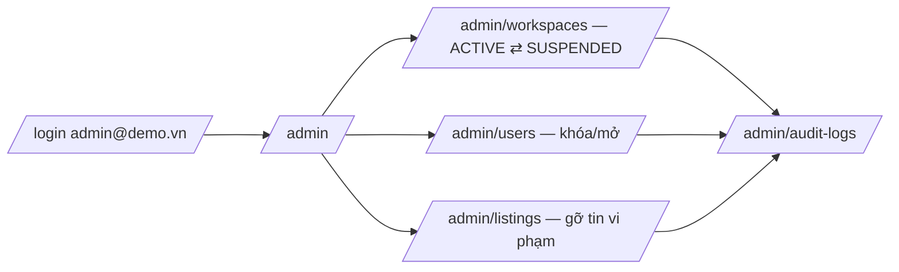

# Luồng người dùng (demo bằng mock)

## F1 — Khách tìm phòng & đặt lịch xem

Thử nhanh: `/` → "Tìm ngay" → "Xem chi tiết" → "Đặt lịch xem phòng" → chọn 14:00 → gửi.

## F2 — Chủ trọ dựng workspace & đăng tin

## F3 — Tạo người thuê → hợp đồng → phòng đang thuê

## F4 — Đơn giá → điện nước → hóa đơn → thanh toán một phần

Demo: kỳ hiện tại có 3 hợp đồng chưa lập hóa đơn (2 phòng thiếu chỉ số C.401/C.402 → ghi ở `/meters` rồi lập lại).

## F5 — Người thuê

Tài khoản `nam@demo.vn` đã liên kết sẵn. Với `minh@demo.vn`: có yêu cầu PENDING; chủ trọ duyệt tại hồ sơ người thuê có nhãn "Chờ duyệt liên kết".

## F6 — Admin

